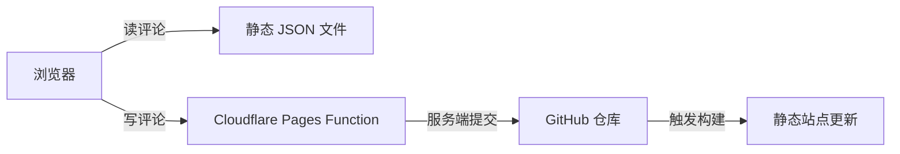
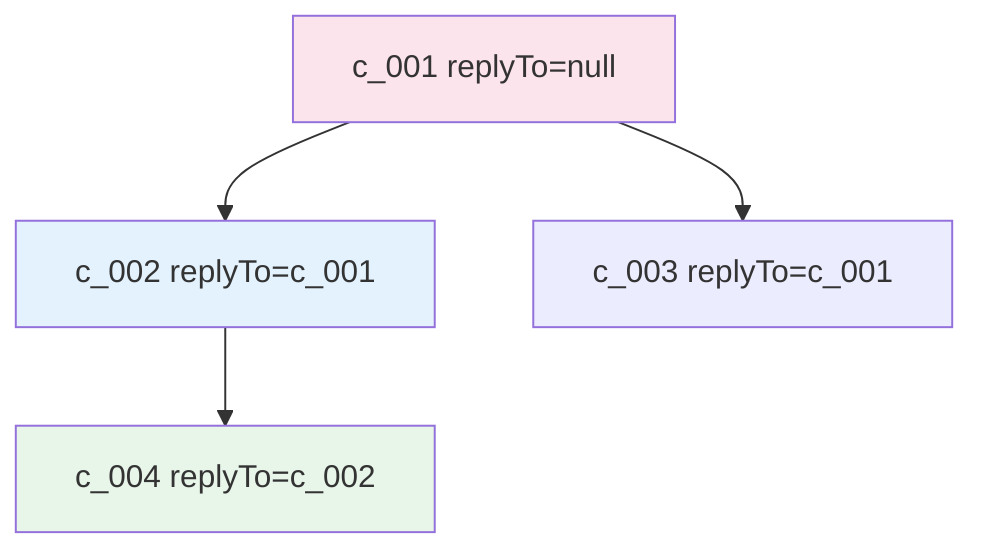
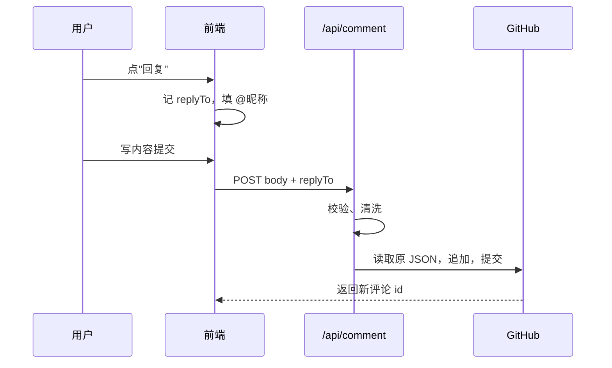
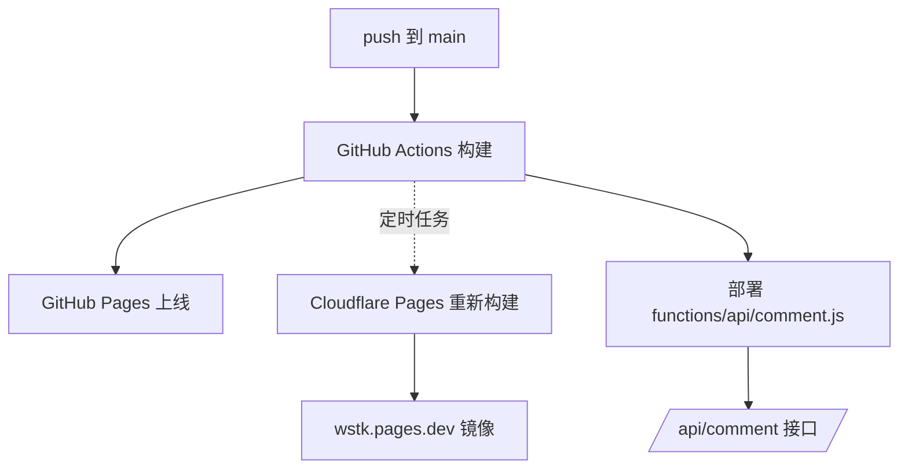

+++
title = "如何通过 CF Pages Function + GitHub 仓库实现评论区构建"
date = "2026-10-15T18:00:00+08:00"
draft = false
description = "静态博客没有后端，评论一般挂第三方服务。这篇文章记录我怎么把评论直接存进自己的 Git 仓库，用 Cloudflare Pages 的 Function 代写提交，以及中间踩的坑。"
categories = [ "网站" ]
tags = [ "website", "cloudflare", "github" ]
cover = "/images/pool/covers/covers-04.avif"
banner = ""
mermaid = true
+++


## 0x00 背景

静态博客没有后端，评论基本只有两条路：挂第三方，或者自己想办法。

第三方用着省事，但问题也不少：有的开始收费，有的停止维护，有的国内访问时快时慢。最主要的是数据不在自己手里，服务一关评论就没了。

所以这次换了个做法：**评论文件放自己的仓库，写评论交给一个 Serverless 函数去提交。**

## 0x10 整体结构



### 四个环节

1. 读：评论就是一个 JSON 文件，浏览器当静态资源取
2. 写：表单提交到 `/api/comment`，这是 Cloudflare Pages 的 Function
3. 存：函数拿 GitHub 令牌调用 Contents API，改文件并提交
4. 生效：仓库变更触发站点重新构建

没有数据库，没有常驻服务器。

## 0x20 评论存在哪

按页面拆文件：

```text
static/comments/
├── posts/
│   ├── stm32f4-interrupt.json
│   └── ubuntu_install.json
├── about.json
└── friend.json
```

文件里是个数组，一条评论长这样：

```json
{
  "id": "c_xxxxx",
  "name": "test",
  "body": "test123456",
  "ts": 1792304863141,
  "hidden": false,
  "author": false,
  "replyTo": ""
}
```

### 两个设计

**扁平存储。** 不管回复多深，全部平铺在一个数组里，靠 `replyTo` 记父评论的 id。加评论就是往数组末尾追加，不用改结构。

**前端递归。** 渲染时根据 `replyTo` 把扁平数组拼回树：



深度不限，想回复到第几层都可以。

## 0x30 读评论

站点部署在两个地方（GitHub Pages 和 Cloudflare Pages），两份文件的更新时间不一样：GitHub Pages 是 push 后一两分钟，Cloudflare Pages 是定时构建，最多滞后两小时。

一开始我想着固定读 Cloudflare 那份（加载快），结果 GitHub Pages 上看到的永远是两小时前的旧评论。

后来改成先读同源的，失败再跨域：

```js
var primary = sameOrigin;
var fallback = crossOrigin;
```

两边各自读自己那份，只有一边挂了才去借另一边的。

## 0x40 写评论为什么要有服务端

往 Git 仓库写文件需要一个有写权限的令牌，这个令牌不能出现在浏览器里（前端代码谁都能看到）。

所以必须有个能接触令牌、用户又碰不到的地方，就是服务端。

我用的服务端是 Cloudflare Pages 的 Function，不用单独开服务器，跟着 Pages 项目一起部署：

```text
functions/api/comment.js    →  /api/comment
```

函数里做三件事：

1. 校验提交内容（长度、字段、来源）
2. 用环境变量里的 `GITHUB_TOKEN` 调 GitHub API
3. 返回结果给前端

## 0x50 安全处理

接口是公开的，得防着被刷。做了三层：

### 令牌最小化

用 GitHub 的 Fine-grained Token，只授权这一个仓库、只给 Contents 读写。泄露了也只能改这个仓库的文件。

### 来源白名单

只接受自己站点的跨域请求：

```js
const allowed = splitEnv(env.ALLOWED_ORIGINS || DEFAULT_ALLOWED_ORIGINS);
if (origin && !allowed.includes(origin)) {
  return json({ ok: false, error: "来源不被允许" }, 403);
}
```

这里踩过一个坑：换自定义域名后，新域名不在白名单里，提交一直报"网络错误"。原因是 CORS 预检请求就被拒了，浏览器只报网络错误，具体得去 Network 面板看 OPTIONS 的状态码。

### 频率限制

同一 IP 短时间提交太多次会被拒。

## 0x60 嵌套回复

点"回复"时前端做两件事：

1. 输入框里塞一个 `@昵称`
2. 记下被回复评论的 id，提交时放 `replyTo`



后端只负责存，不做嵌套判断；嵌套是前端渲染时按 `replyTo` 现拼的。以后想换渲染方式，后端不用动。

## 0x70 分页

评论多了要分页，这里容易做错：直接"每页 10 条"会把回复和父评论分到两页。

我的做法是按顶层线程分页：

- 每页 10 条顶层评论
- 每条顶层评论下面挂它全部回复，不管多少条
- 线程内按时间升序，线程之间按最新一条的顺序降序

这样翻页时，每个线程的上下文都是完整的。

## 0x80 刚发的评论看不到

这是静态站点做评论必然遇到的问题。

提交成功，刷新页面——没有。因为评论存进仓库后要等站点重新构建才会变成可访问的文件。GitHub Pages 大概一两分钟，Cloudflare Pages 要等下一次定时构建。

处理方式是提交后不立刻刷新，隔一段时间轮询，检测到新评论出现了再提示"评论已显示在下方"。页底也写清楚了：

> 提交后约一分钟显示；访问 wstk.pages.dev 的话内容最多滞后 2 小时

## 0x90 踩坑记录

**令牌过期。** 突然所有提交都失败，报 `401 Bad credentials`。Fine-grained Token 有有效期，到期要换。现在把"还剩几天过期"做进了管理接口。

**回复不嵌套。** 一开始点"回复"只往输入框塞了 `@昵称`，提交时根本没带 `replyTo`，后端一直按普通评论存，嵌套永远不生效。这个问题过了很久才被发现。

**前端变量写错，评论区整个消失。** 改代码时引用了一个不存在的变量，控制台报错，评论区直接不渲染。修改完成后应当实际打开页面确认，不能只看构建是否成功。

**跨域预检被拒。** 就是 0x50 里那个白名单问题。

## 0xA0 这套方案的代价

**有延迟。** 评论要等构建完才出现，不是实时的。

**要维护令牌。** 一个 PAT 到期要换，好在可以提前预警。

**不适合高并发。** 每次提交都是一次 Git commit，几百条同时来承受不了。

个人博客一天评论数量不多，这三点都在可接受范围内。


## 0xB0 部署到 Cloudflare 要做什么

原理讲完之后，实际操作其实没几步。

### 目录放对

Function 的文件放在仓库根目录的 `functions/` 下：

```text
functions/
└── api/
    └── comment.js     →  部署后就是 /api/comment
```

Cloudflare Pages 在构建时会自动扫描这个目录，每个导出 `onRequestPost` / `onRequestGet` 的文件就变成一个接口，不需要额外配置路由。

### 配环境变量

进入 Cloudflare Pages 项目的 Settings → Variables and secrets，加这几条：

- `GITHUB_TOKEN`：类型选 Secret，值是 GitHub 的 Fine-grained Token
- `COMMENT_MODE`：`direct`（直接发布）或 `pending`（先待审核）
- `COMMENT_PENDING`：`true` / `false`，控制是否需要审核
- `ALLOWED_ORIGINS`：允许提交评论的域名，逗号分隔

### 改完必须重新部署

**这一步比较容易遗漏。** Cloudflare Pages 的环境变量是版本化的，改完之后必须重新部署一次（Deployments → 重新部署），Functions 才能读到新值。

我第一次配置时就卡在这里：变量明明填了，提交评论还是报错，最后发现线上运行的仍然是旧版本。

### 顺带说一下镜像站

站点其实部署在两处：GitHub Pages 和 Cloudflare Pages。后者就是个镜像（`wstk.pages.dev`），由定时任务通过 Deploy Hook 触发构建，所以内容最多滞后两小时。



评论区用的接口跑在 Cloudflare 那侧，所以就算主站是 GitHub Pages，提交评论也不受影响。

### 免费额度

Pages Functions 每天 10 万次请求，个人博客完全用不完。真正需要注意的是一次性并发——每次提交都是一次 Git commit，短时间大量提交会互相冲突。

> 本文和评论系统由 AI ~~辅助~~*生成，内容依据本站实际实现整理，代码细节以仓库源码为准。
