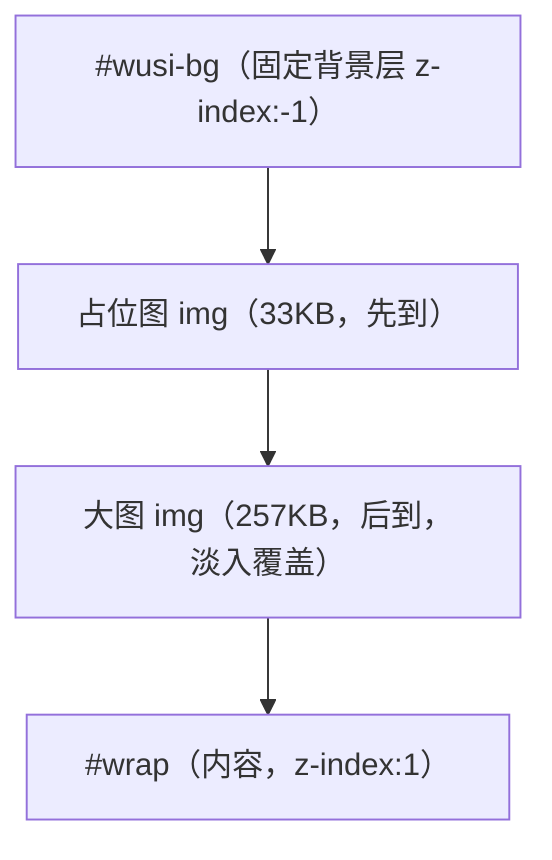
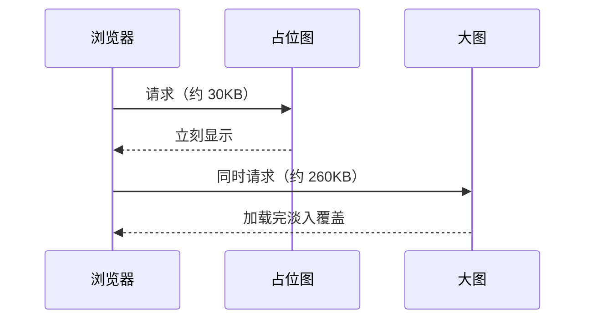

+++
title = "如何通过 img 层 + CSS 变量实现随机固定背景与站点视觉效果"
date = "2026-10-15T21:30:00+08:00"
draft = false
description = "记录本站随机固定背景的实现过程：从主题不透明底色的坑，到首屏占位图、大图淡入、毛玻璃卡片和文字可读性处理，以及中间踩过的几个坑。"
categories = [ "网站" ]
tags = [ "website", "hugo", "css" ]
cover = "/images/pool/covers/covers-05.avif"
banner = ""
mermaid = true
+++

（本文整理自本站背景与视觉效果的实现过程，留作备查）

开工之前，先感谢两位：

- [D-SKETON](https://d-sketon.github.io)：主题 [reimu](https://github.com/D-SKETON/hugo-theme-reimu) 的作者。本站的整体框架和大量视觉效果原型都来自这个主题，本文提到的许多改造，也是在他的主题基础上完成的。
- [CialloKing](https://cialloking.github.io)：背景图池取自他的站点，页脚那些随机背景图就来自这里，图池引用链的思路也参考了他的做法。

## 0x00 想要什么效果

想法很简单：页面背景是一张随机番剧图，固定不动，内容像一张半透明的卡片浮在上面。暗色模式下文字和卡片也要能看清。

听起来不难，但主题自带的背景是纯色，直接加背景图会被盖住。中间改了好几轮才对。

## 0x10 第一个坑：主题的底色

改之前先看了下主题的 CSS，发现有两层不透明底色：

```css
body { background: var(--color-background); }
#wrap {
  position: absolute;
  z-index: 1;
  background: var(--color-background);
}
```

`#wrap` 这层是**绝对定位 + z-index:1**，也就是内容容器本身不透明。不管把背景垫在它下面多少层，都会被挡住。

一开始只改了 `body` 的背景，页面上什么都看不见——因为真正挡住的不是 body，是 `#wrap`。

解决办法是把这两层的底色都放开：

```css
body, #container, #wrap { background: transparent !important; }
```

然后单独建一个固定层放背景图。

## 0x20 背景层怎么搭

结构是这样的：



两层图叠在一起：占位图先出来，大图加载完再淡入盖住。这样不管大图多慢，首屏都不会空着。

代码里用 JS 动态建层，不写死在 HTML 里：

```js
var layer = document.createElement('div');
layer.style.cssText = 'position:fixed;inset:0;z-index:-1;background-size:cover;';
```

## 0x30 固定不滚动

固定这一点靠 `position: fixed`，不是 `background-attachment: fixed`。

后者在某些浏览器和某些滚动场景下会失效，而且移动端支持很差。用独立的 div 加 `position:fixed` 最稳。

也顺手踩了个坑：一开始用了 `width:100vw`，结果页面出现了横向滚动条。原因是 `100vw` 包含滚动条的宽度。改成 `inset: 0`（或者 `width:100%`）就正常了。

## 0x40 首屏：占位图和大图

背景图是随机抽的，原来单张平均 791KB，最大 2.5MB。这么大的图直接当背景，首屏会白一下。

后来做了两层：

- **占位图**：10 张缩到 480px 宽的小图，每张约 30KB，放在主仓库里
- **大图**：111 张缩到最长边 1920px、quality 82，每张约 260KB，放在 media 分支



打开页面时先铺占位图，大图在后台加载。实测大图要 3 秒才到（远端图源），但页面早就可用了。

## 0x50 预加载遮罩

主题有个"少女祈祷中"的全屏遮罩，要等 `window.load` 才收起，也就是等所有资源加载完——包括那张 260KB 的背景大图。结果就是遮罩停留 1~2 秒。

这里有个坑值得记：主题的 `#loader` 里，`loading` 这个类名表示**已隐藏**，不是"加载中"。

```js
// loader-tip.js 里的注释写得很清楚
if (loader.classList.contains('loading')) { return; } // 已经隐藏
```

所以想"收起遮罩"要 `add('loading')`，写成 `remove('loading')` 会把已经收起的遮罩重新显示出来，永久盖住整站。

最后做了两件事：

1. 兜底图可见时确保遮罩已收起（`add('loading')`，幂等）
2. 把遮罩滑出动画从 0.8 秒压到 0.15 秒

改完实测：冷缓存下遮罩从 803ms 降到 386ms。

## 0x60 毛玻璃卡片

主体内容做成半透明卡片，背景透出来一点：

```css
#wrap .article-entry {
  background: rgba(255, 255, 255, 0.9);
  backdrop-filter: blur(10px);
}
```

暗色模式单独一套：

```css
html[data-theme="dark"] #wrap .article-entry {
  background: rgba(39, 43, 48, 0.92);
}
```

两个细节：

**一是 `backdrop-filter` 有兼容问题**，不支持的时候要做降级，直接把透明度调高接近不透明，否则文字会糊在背景上。

**二是悬停时更透一点**，鼠标移到页面上卡片透明度降一点，移开恢复。纯 CSS 过渡就能实现，不用 JS。

## 0x70 文字可读性

背景是图片，最怕的是文字压在上面看不清。

页脚和头部标题这两块的文字是直接压在背景上的，随机换图时会出现"白底白字"的情况。处理方式是给它们加一块半透明面板：

```css
#header-title, #footer {
  background: rgba(255, 255, 255, 0.72);
  backdrop-filter: blur(3px);
  border-radius: 12px;
}
```

暗色模式换成深色面板，文字颜色也跟着切。这样不管背景图是什么颜色，文字都能看清。

文章结尾的"上一篇/下一篇"也一样处理——那块的文字压在背景上，加了深色底和文字阴影。

## 0x80 背景图池怎么存

背景图有 111 张原图，一共 86MB，全放进主仓库不现实。所以放到了 media 分支：

```text
media 分支
└── images/pool/
    ├── bg/       111 张原图
    └── bg-web/   111 张显示版（1920px / q82，共 29MB）
```

构建时从 media 拉下来，按 commit 哈希做缓存，media 没变化就不重复下载。

页面里引用的是 `/images/pool/bg-web/xxx.webp`，站内路径，不依赖外部图源。

## 0x90 踩过的坑

**底色被 #wrap 挡住。** 只改 body 没用，得把 #wrap 也放开。

**100vw 导致横向滚动条。** 换成 inset:0。

**遮罩类名理解反了。** `loading` 是已隐藏，不是加载中。写反了会永久遮挡。

**首屏白一下。** 大图加载前页面空着，加占位图解决。

**遮罩收起太慢。** 主题的滑出动画 0.8 秒，改成 0.15 秒。

## 0xA0 代价

**图片流量。** 每次访问要加载一张 260KB 的背景，比纯色背景多不少。虽然走了 CDN 缓存，但流量还是实打实的。

**构建变慢。** 拉取图片池要多花一两分钟（缓存命中就不花）。

**CSS 越来越长。** 站点级覆盖样式已经有好几个文件，主题升级时得跟着检查。

> 本文由 AI 辅助生成，内容依据本站实际实现整理，代码细节以仓库源码为准。
